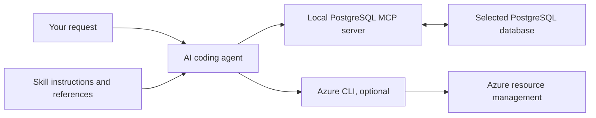

# Postgres Skills

[](LICENSE)
[](#get-started)

**Postgres Skills is a plugin for Claude Code, GitHub Copilot CLI, and Codex CLI that equips
your AI coding agent with PostgreSQL guidance and database tools.** Use it to build,
troubleshoot, and operate PostgreSQL across local, self-hosted, and cloud environments,
including Azure Database for PostgreSQL and Azure HorizonDB.

It bundles two skills with 33 reference guides and a local PostgreSQL MCP server.
**It is not a PostgreSQL extension, database service, or standalone AI assistant.**
You bring a supported agent and choose which database it can access.

[Get started](#get-started) · [How it works](#how-it-works) ·
[Examples](#real-world-examples) · [Full catalog](#sub-skill-catalog)

## Is this for me?

### Who it's for

- **Application developers** building PostgreSQL-backed apps, schemas, and queries.
- **DBAs and platform engineers** investigating performance and managing database operations.
- **AI application developers** building vector search, retrieval-augmented generation
  (RAG), and knowledge graphs.

### Workloads it's useful for

| Your task | How the plugin helps |
|-----------|----------------------|
| Diagnose a slow query | Inspect the live schema and query plan, then propose a targeted change. |
| Choose indexes or partitioning | Match the design to your queries, data, and PostgreSQL version. |
| Build search and AI features | Guide vector indexing, hybrid retrieval, and RAG implementation. |
| Add tenant isolation | Design row-level security policies around your tenancy model. |
| Investigate connection or service issues | Check the selected environment and follow the relevant PostgreSQL or Azure workflow. |
| Build a knowledge graph | Propose an ontology for review, load it into Apache AGE, and query relationships with openCypher. |

### What you're probably doing today instead

You may already use an AI agent and database tools. This plugin adds PostgreSQL-specific
instructions and references to that workflow.

| Today's friction | What Postgres Skills adds |
|------------------|--------------------------|
| Copying schema and settings into prompts | Instructions to inspect the selected database and ground recommendations in its context. |
| Checking generated SQL against documentation | Version-aware guidance and common PostgreSQL pitfalls. |
| Translating self-hosted commands into managed-service operations | Separate generic, Azure Database for PostgreSQL, and HorizonDB guidance. |
| Switching between advice, SQL tools, and cloud commands | A shared agent workflow using PostgreSQL MCP tools and, for Azure operations, the Azure CLI. |

## Get started

Already have Claude Code, GitHub Copilot CLI, or Codex CLI? You also need
[Node.js LTS](https://nodejs.org/en/download) with `npx` available to launch the MCP server.
If you're starting from scratch, follow the [first-time setup guide](plugin/SETUP.md#starting-with-nothing).

1. **Install the plugin** from your terminal for the agent you use:

   | Agent | Installation commands |
   | --- | --- |
   | Claude Code | `claude plugin marketplace add microsoft/postgres-skills`<br>`claude plugin install postgres-skills@postgres-skills` |
   | GitHub Copilot CLI | `copilot plugin marketplace add microsoft/postgres-skills`<br>`copilot plugin install postgres-skills@postgres-skills` |
   | Codex CLI | `codex plugin marketplace add microsoft/postgres-skills`<br>`codex plugin add postgres-skills@postgres-skills` |

2. **Start a new agent session** so it can load the plugin's skills and MCP tools.
   Review any tool-access prompts before allowing access.

3. **Connect read-only and try an inspection task:**

   ```text
   Help me connect to my PostgreSQL database using a read-only profile.
   Then show my table names and approximate sizes without reading application rows.
   ```

   Have your host, port, database name, and user name ready. Enter the password only
   in the hidden password prompt, never in chat. See the [connection setup](plugin/SETUP.md#configure-a-database-connection)
   and [data-access disclosure](plugin/SETUP.md#data-access-and-privacy) before
   connecting a sensitive or production database.

### Skills only, without database tools

Use [skills.sh](https://skills.sh) if you want the guidance without the bundled MCP server:

```text
npx skills add microsoft/postgres-skills --full-depth
```

Choose `postgresql-best-practices`, `pg-graph`, or both. This does not install the
PostgreSQL MCP server or establish a database connection. For live database work,
use the full plugin above or configure your own compatible tools.

<details>
<summary>Install an individual skill</summary>

```text
npx skills add microsoft/postgres-skills --skill postgresql-best-practices --full-depth
npx skills add microsoft/postgres-skills --skill pg-graph --full-depth
```

</details>

## How it works

The AI agent reads skill instructions and chooses tools. The skills themselves do not
execute SQL or run a background service.

| Component | Role |
|-----------|------|
| **Your AI agent** | Interprets your request, loads relevant guidance, and invokes available tools. |
| **Two skills** | `postgresql-best-practices` routes PostgreSQL and Azure questions to reference guides. `pg-graph` covers ontology design, graph construction, and openCypher queries. |
| **PostgreSQL MCP server** | Runs locally through `npx` and sends queries and approved changes to the database you select. MCP stands for Model Context Protocol, the interface between the agent and its tools. |
| **Azure CLI, optional** | Handles Azure resource operations after you install it and authenticate. It is not required for generic PostgreSQL work and the plugin does not install it. |



For example, ask: **"My query went from 200ms to 8 seconds after deployment."**

1. The agent loads query-performance guidance and checks the selected connection.
2. It inspects the relevant schema, settings, and query plan with read-only tools.
3. It explains the evidence and proposes a change, including the target and impact.
4. The skills instruct it to request approval before a write. After an approved change,
   it checks the result and reports any remaining uncertainty.

Available operations depend on your database permissions, extensions, service features,
and agent tool-access settings. The plugin does not grant privileges.

### What changes in your architecture

The plugin extends your development tools, not your application's request path. Your app
can keep its existing database driver, schema, and deployment architecture.
Installing the plugin configures a local MCP process; it does not install PostgreSQL
extensions or change database objects. Particular tasks may require separately approved
extensions, such as `vector` for vector search or `age` for graph work.

### When not to use it

- **You need an application database driver or production chatbot backend.** This is an
  agent plugin, not an application runtime or ready-made end-user chat service.
- **You need unattended database administration or guaranteed fixes.** Keep monitoring,
  incident response, and human review in place.
- **You need versioned schema deployment.** Keep your migration framework and CI/CD
  process; review agent-generated changes through your normal workflow.
- **Your policies prohibit sending database metadata or results to an AI provider.**
  Use skills-only guidance with approved, non-sensitive context instead.
- **You only need to run a known SQL statement.** Your existing SQL client may be enough.

## Security, permissions, and privacy

Your agent launches the plugin's configured
[`@microsoft/postgres-mcp`](https://github.com/microsoft/postgres-mcp) locally
through `npx`. The MCP server can access the database selected by the user and
has the permissions of that PostgreSQL role. Query results and diagnostics
returned by the server become part of the user's AI-assistant interaction.

Use a dedicated, least-privilege role and a read-only connection profile for
exploration. The skills instruct the agent to request explicit confirmation before
database writes, CSV imports, graph writes, or Azure resource changes. These are
agent instructions, not a database-enforced approval system. Enforce access through
PostgreSQL roles, connection access modes, and your agent's tool permissions; do not
enable blanket approval for write tools. The skills also instruct the agent to treat
database content as untrusted data and retrieve only what the task needs.

The bundled MCP configuration disables postgres-mcp telemetry and does not
transmit database content to Microsoft for plugin telemetry. Package installation
requires access to the npm registry, and Azure workflows may use the Azure CLI
to communicate with Azure after the user authenticates. See the
[plugin setup and data-access disclosure](plugin/SETUP.md) before connecting a
sensitive or production database.

## Real-world examples

| Try asking | Agent workflow |
|------------|----------------|
| **"My query went from 200ms to 8 seconds after deployment."** | Inspect the plan and schema, explain likely causes, and propose a change for review. |
| **"Set up vector search for my product catalog."** | Check extensions and indexing options for your environment, then request approval before applying changes. |
| **"Turn my documents into a knowledge graph."** | Sample approved data, propose an ontology for review, and load the graph only after confirmation. |

<details>
<summary>More examples: PostgreSQL, Azure, and graph workloads</summary>

### PostgreSQL anywhere

**"What tables do I have, and which are the biggest?"**
→ Introspects your live schema and reports tables, row estimates, and sizes.

**"Set up vector search for my product catalog"**
→ Selects the right vector index for your environment and applies the extension and index after you confirm.

**"My query went from 200ms to 8 seconds after deployment"**
→ Analyzes the live execution plan and buffer usage to identify the regression.

**"Add multi-tenant isolation to these tables"**
→ Designs row-level security policies for your tenancy model and applies them after confirmation.

**"Partition my 500M-row events table by month"**
→ Designs the partition layout, checks pruning requirements, and applies the DDL with confirmation.

**"Index my JSONB documents for containment queries"**
→ Examines the query pattern and proposes the appropriate GIN index for approval.

### Azure Database for PostgreSQL and HorizonDB

**"Batch-embed 1 million rows using SQL"**
→ After approval, uses `azure_ai` SQL functions to call the configured model service in batches while respecting service limits. This can send source text to the model provider and incur inference charges.

**"Provision a General Purpose server and scale it to 8 vCores"**
→ Selects the right Azure resources and provisions or scales the server after confirmation.

**"Change `work_mem` on my Azure server"**
→ Clarifies server-wide vs per-database scope, validates the current configuration, and safely applies the parameter change.

**"Set up zone-redundant HA and add a read replica"**
→ Configures high availability and a read replica with the required topology and safety checks.

**"Roll my database back to 2pm yesterday"**
→ Validates the restore window and creates a point-in-time restored server after confirming the target time.

**"I accidentally deleted my server yesterday — get it back"**
→ Finds the delete event in the activity log and, after confirmation, revives the server from its retained backup within the 5-day window.

**"I can't connect — 'SSL connection is required'"**
→ Diagnoses firewall, private endpoint, VNet, DNS, and certificate configuration.

**"Add passwordless Entra ID authentication to my app"**
→ Generates the application connection code and managed-identity configuration.

**"Upgrade my server from PG13 to PG16"**
→ Validates extension and application compatibility and performs the required pre-check before the upgrade.

**"Create an Azure HorizonDB cluster and enable pgvector"**
→ Recognizes the HorizonDB environment and uses cluster and parameter-group guidance instead of applying Flexible Server workflows.

### Graph workloads with Apache AGE

**"Turn my documents into a knowledge graph"**
→ Samples your data, proposes node labels, edge types, and properties for review, then safely MERGE-loads the approved graph into Apache AGE.

**"Generate an ontology from my existing tables"**
→ Reads your schema and foreign keys and proposes tables as node labels and relationships as edges for review before anything is built.

**"Answer this by traversing my graph"**
→ Introspects the graph schema, then generates and runs a validated openCypher query.

**"Visualize my graph in VS Code"**
→ Returns complete vertices and edges with display labels for the PostgreSQL extension for VS Code graph viewer. Visualization requires that extension separately.

**"Why did the graph recommend this?"**
→ Returns the reasoning path, provenance, and confidence bounded by the weakest supporting edge.

</details>

## Sub-skill Catalog

The plugin contains two installable skills and 33 reference guides, grouped below.
"Sub-skills" refers to those guides, not 33 separate plugins.

<details>
<summary>Browse all 33 reference guides: 11 PostgreSQL, 12 Azure, and 10 graph</summary>

### PostgreSQL Foundational (11 sub-skills)

These sub-skills work with any PostgreSQL deployment — self-hosted, RDS, Cloud SQL, Azure, or local.

| Sub-skill | Helps you with | What the agent learns that LLMs get wrong |
|-----------|---------------|------------------------------------------|
| **postgresql-vector-search** | pgvector setup, HNSW indexes, distance operators | Index type selection, recall tuning, operator/index mismatch |
| **postgresql-genai-rag** | RAG pipelines, hybrid search, chunking | RRF scoring, dimension mismatch, FTS + vector combination |
| **postgresql-extensions** | Extension install/upgrade, troubleshooting | shared_preload_libraries restart requirement, version compatibility |
| **postgresql-advanced-indexing** | B-tree, GIN, GiST, BRIN, partial indexes | Covering indexes, index-only scan prerequisites, deduplication (PG13+) |
| **postgresql-jsonb-patterns** | JSONB operators, indexing, query patterns | `jsonb_path_query` (PG12+), GIN trigram anti-patterns, containment vs existence |
| **postgresql-table-partitioning** | Range/list/hash partitioning | Partition pruning failures, default partition traps, PG14+ `DETACH CONCURRENTLY` |
| **postgresql-row-level-security** | Multi-tenant RLS policies | Policy stacking, leaky view anti-patterns, performance with 1000+ tenants |
| **postgresql-full-text-search** | tsvector, tsquery, ranking | Phrase search (PG9.6+), custom dictionaries, weighted ranking |
| **postgresql-connection-management** | Pooling, timeouts, connection lifecycle | `work_mem` multiplication in pools, prepared statement mode traps |
| **postgresql-replication** | Publications, subscriptions, CDC | Row filter (PG15+), conflict resolution, initial data sync strategies |
| **postgresql-query-performance** | EXPLAIN analysis, vacuum, statistics | JIT thresholds, parallel query pitfalls, vacuum/bloat tuning |

### Azure Database for PostgreSQL (12 sub-skills)

These sub-skills are gated by the connection capability check. They cover managed-service workflows, Azure AI integrations, and platform-specific safety guardrails.

Each Azure reference also includes an *On Azure HorizonDB* section. For a HorizonDB
connection (`*.horizondb.azure.com`), the skills direct the agent to cluster,
`az horizondb`, and parameter-group guidance instead of Flexible Server commands.
Feature availability differs by service and deployment; verify it before acting.
See [Azure HorizonDB](https://learn.microsoft.com/en-us/azure/horizondb/overview).

| Sub-skill | Helps you with | What the agent learns that LLMs get wrong |
|-----------|---------------|------------------------------------------|
| **azure-postgresql-vector-diskann** | DiskANN for billion-scale vector search | `lists` vs `m`/`ef_construction` tuning, DiskANN is Azure-only |
| **azure-postgresql-genai-patterns** | SQL-driven embeddings and RAG with azure_ai | External model calls, batch processing limits, rate limit handling, Path A vs B decision |
| **azure-postgresql-azure-ai** | azure_ai extension setup, AI functions | `create()` vs `create_embeddings()`, managed identity config |
| **azure-postgresql-intelligent-tuning** | Query Store, index recommendations | Query Store must be enabled first, `pg_qs.query_capture_mode` |
| **azure-postgresql-entra-id-auth** | Passwordless auth with Entra ID | Token refresh before 5-min expiry, managed identity setup |
| **azure-postgresql-connection-pooling** | Built-in PgBouncer configuration | Prepared statements break in transaction mode |
| **azure-postgresql-ha-disaster-recovery** | Zone-redundant HA, PITR, geo-replicas | Forced vs planned failover, PITR creates NEW server |
| **azure-postgresql-restore-deleted-server** | Recovering a deleted server, delete locks | 5-day window, `ReviveDropped` via `az rest` (no `az postgres flexible-server` subcommand), same subscription/region, HorizonDB clusters unrecoverable |
| **azure-postgresql-networking-ssl** | Private endpoints, VNet, SSL | VNet chosen at creation (can't change), DigiCert G2 cert |
| **azure-postgresql-provisioning** | IaC, SKU selection, scaling | Burstable limits, storage can't shrink, IOPS scaling |
| **azure-postgresql-extension-lifecycle** | Extension allowlisting on Azure | `azure.extensions` param, `azure_pg_admin` role requirement |
| **azure-postgresql-upgrades-maintenance** | Major version upgrades, maintenance | MVU is one-way, no skip-version, `--validate-only` pre-check |

### Graph on PostgreSQL — Apache AGE (pg-graph, 10 sub-skills)

The **pg-graph** skill is the single home for graph work on PostgreSQL, covering the full lifecycle: derive an ontology from your data (with a human feedback loop), build the graph, and query it with openCypher, natural-language-to-Cypher, and graph-augmented retrieval. It uses only capabilities available today — agent-driven extraction over the MCP query tools (any PostgreSQL with AGE) or the `azure_ai` extension for in-database work at scale on Azure.

| Sub-skill | Helps you with | What the agent learns that LLMs get wrong |
|-----------|---------------|------------------------------------------|
| **ontology-derivation** | Deriving a graph ontology from structured or unstructured data with a human feedback loop | Never finalize an ontology without user approval; agent-driven vs `azure_ai` modes; no unreleased `ai.*` primitives |
| **extract-to-graph** | Extracting, deduplicating, and MERGE-loading entities into AGE from a finalized ontology | Idempotent `MERGE` on stable business keys to avoid duplicate vertices across repeated extraction |
| **context-dedup** | Entity resolution and canonicalization of aliases | Blocking for scale, persistent canonical map, resolving via type + graph neighborhood + source snippet |
| **opencypher-age-patterns** | AGE setup, Cypher wrapping, MATCH/MERGE/CREATE, indexing vertices and edges | Cypher must be wrapped in `ag_catalog.cypher(...)` with a column definition list; `search_path` ordering |
| **text-to-cypher** | Turning a natural-language question into a validated openCypher query | Ground on schema first, `agtype` casting, no host bind parameters inside `$$...$$`; return full objects + `disp_label` for VS Code graph visualization |
| **graph-schema-introspection** | Discovering labels, edge types, and properties | Use the `ag_label` catalog so generated Cypher is grounded, not hallucinated |
| **graph-augmented-rag** | Retrieval combining vector similarity with graph traversal and reranking | Hybrid graph retrieval that goes beyond flat vector search |
| **graph-explainability** | Provenance, reasoning paths, and explainable recommendations | Confidence bounded by the weakest edge on the path; reproducible reasoning trace |
| **azure-ai-semantic-search** | Enabling and configuring `azure_ai` and generating embeddings for semantic search | Read current settings and ask for endpoint/key/deployment — never invent them |
| **examples** | End-to-end worked graph examples spanning schema, query, and results | Grounded in the wrapping and safety rules from the other pg-graph sub-skills |

</details>

## Contributing

See [CONTRIBUTING.md](CONTRIBUTING.md) for guidelines on adding or improving skills and sub-skills.

## License

[MIT](LICENSE)

## Trademarks

This project may contain trademarks or logos for projects, products, or services. Authorized use of Microsoft trademarks or logos is subject to and must follow [Microsoft's Trademark & Brand Guidelines](https://www.microsoft.com/en-us/legal/intellectualproperty/trademarks/usage/general). Use of Microsoft trademarks or logos in modified versions of this project must not cause confusion or imply Microsoft sponsorship. Any use of third-party trademarks or logos are subject to those third-party's policies.
