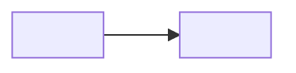
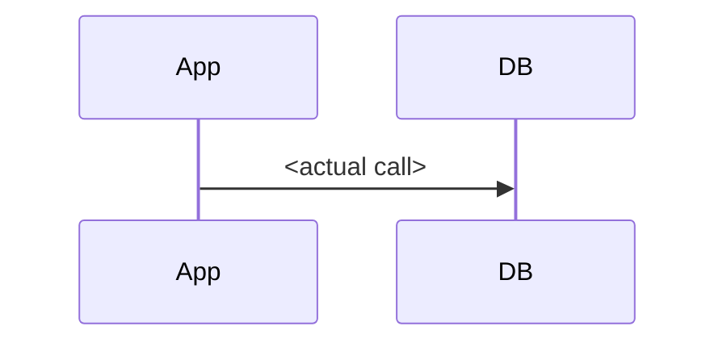
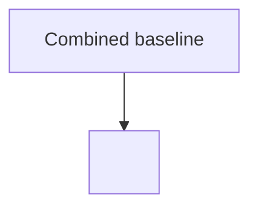

# Oracle to PostgreSQL Application Code Assessment

**Run:** `<run-id>` · **Mode:** `<mode>` · **Repository:** `<name>` on `<branch>` at `<commit>` · **Target:** `<sanitized target>` · **Plugin:** `<version>`

**Evidence note:** `<commands/evidence provenance and limitations>`

## Table of Contents

- [Executive Summary](#executive-summary)
- [Application & Database Architecture](#application-database-architecture)
- [Migration Impact Assessment](#migration-impact-assessment)
- [PostgreSQL Target Readiness](#postgresql-target-readiness)
- [Test & Validation Readiness](#test-validation-readiness)
- [Conversion Success Criteria](#conversion-success-criteria)
- [Assessment Outcome](#assessment-outcome)
- [Coding Notes Processing](#coding-notes-processing)
- [Appendix / Run Evidence](#appendix-run-evidence)

## Executive Summary

`<overall assessment and recommendation>`

| Area | Evidence / consequence | Status |
|---|---|---|
| `<area>` | `<evidence>` | `<emoji + title-case status>` |

[Back to Top](#top)

## Application & Database Architecture

### Application Overview

`<runtime, entry points, persistence boundaries, artifacts, database surface, tests>`

### Codebase Architecture Map

### Codebase / Database Dependency Map

### Critical Interaction Sequence

[Back to Top](#top)

## Migration Impact Assessment

### Oracle Migration Hotspots

| Hotspot | Evidence / scope | Status | Conversion action / impact |
|---|---|---|---|
| `<category>` | `<paths/count>` | `<emoji + title-case status>` | `<action>` |

[Back to Top](#top)

## PostgreSQL Target Readiness

### Extracted Oracle DDL Source

| Supplied | Input root → resolved schema folder | Layout | Indexed files / objects | Invalid / ambiguous entries | Missing target objects matched | Result |
|---|---|---|---:|---:|---:|---|
| `<yes/no>` | `<sanitized input root → relative schema path or Not supplied>` | `<canonical/flexible/not supplied>` | `<files / objects>` | `<count>` | `<count>` | `<emoji + title-case result>` |

State that the source folder is read-only and that Oracle bodies are omitted from the report. List
each missing target object with its unique Oracle source identity/path or exact unresolved reason.

| Missing PostgreSQL object | Oracle source object | Source DDL file / digest | Reconstruction provenance | Body completeness / confidence | Customer validation |
|---|---|---|---|---|---|
| `<schema.object(signature)>` | `<schema.object or package.member>` | `<relative path / short SHA-256 or Not found>` | `<oracle-ddl / code-and-tests / best-effort / fail-closed>` | `<complete/inferred/missing + high/medium/low>` | `<not required or exact required action>` |

| Required object/capability | Required | Found / verified | Missing / not verified | Status |
|---|---:|---:|---:|---|
| `<kind>` | `<count>` | `<count>` | `<count>` | `<emoji + title-case status>` |

[Back to Top](#top)

## Test & Validation Readiness

### Baseline Provenance

| Baseline | Command | Tests | Result / limitation |
|---|---|---:|---|
| Untouched raw attempt | `<command>` | `<count>` | `<result>` |
| Enabled baseline | `<command>` | `<count>` | `<result>` |

### Test Discovery Reconciliation

| Language | Framework / adapter | Source files | Test cases | Adapter available | Eligible containers | Executed containers | Executed tests | Missing containers | Result |
|---|---|---:|---:|---|---:|---:|---:|---:|---|
| `<language>` | `<framework / adapter>` | `<count>` | `<count>` | `<yes/no + dependency/build evidence>` | `<count>` | `<count>` | `<count>` | `<count>` | `<emoji + title-case result>` |

State the reviewed `test-discovery-baseline.json` path, minimum counts, representative tests,
runner safety settings, and any intentional reviewed exclusions. A successful build exit is not
discovery evidence.

### Code Coverage

#### Coverage by Lane

| Lane | Scope | Tests / engines | Line coverage | Branch coverage | Evidence |
|---|---|---|---:|---:|---|
| `<framework/toolchain lane>` | Original production classes — fixed comparison set | `<tests/adapter/environment>` | `<covered/total (%)>` | `<covered/total (%)>` | `<path>` |
| 🔗 Integration | `<scope>` | `<tests/provider>` | `<covered/total (%) or unavailable>` | `<covered/total (%) or unavailable>` | `<path/reason>` |
| 📊 Combined | `<scope>` | `<tests/provider>` | `<covered/total (%)>` | `<covered/total (%)>` | `<path>` |

#### Coverage Heatmap

#### Migration-Sensitive Coverage

| Module / path | Behavior / boundary | Existing tests | Line coverage | Branch coverage | Gap / next action |
|---|---|---|---:|---:|---|
| `<path>` | `<behavior>` | `<lane/evidence>` | `<value>` | `<value>` | `<action>` |

[Back to Top](#top)

## Conversion Success Criteria

| Criterion | Required evidence |
|---|---|
| `<criterion>` | `<measurable evidence>` |

[Back to Top](#top)

## Assessment Outcome

`<emoji + title-case decision>`

| Decision field | Outcome |
|---|---|
| Automated conversion scope | `<scope>` |
| External prerequisites | `<prerequisites>` |
| Validation target | `<gates>` |

[Back to Top](#top)

## Coding Notes Processing

`<generated by coding-notes.mjs from codingNotes; native task-list items, never table checkboxes>`

[Back to Top](#top)

## Appendix / Run Evidence

### Effective Options

| Option | State | Result |
|---|---|---|
| `<option>` | `<On/Off>` | `<action/result>` |

### Assessment Methodology & Baseline Adjustments

`<exact changes, authorization, rollback>`

### Commands and Evidence

| Activity | Command / evidence | Result |
|---|---|---|
| `<activity>` | `<command/path>` | `<result>` |
| Report artifact validation | `validate-migration-artifacts.mjs` command/result | `<result>` |

### Run Metrics

**Time zone:** `<machine-local IANA time zone captured at run start>`

| Phase | Start | Completed | Wall Clock Duration |
|---|---|---|---|
| Assessment | `<readable start>` | `<readable completed>` | `<readable duration>` |
| Conversion | Not run | Not run | Not run |
| Total Runs | `<readable start>` | `<readable completed>` | `<readable duration>` |

[Back to Top](#top)
