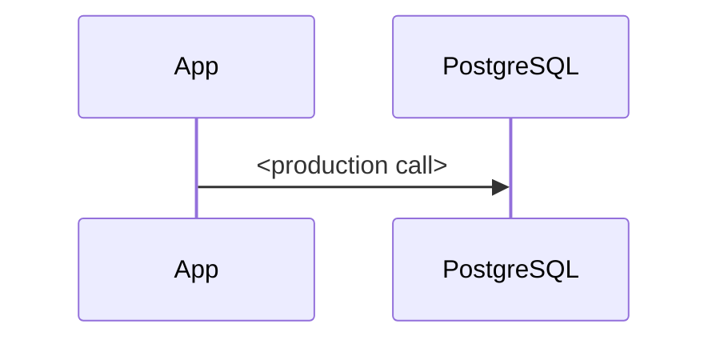
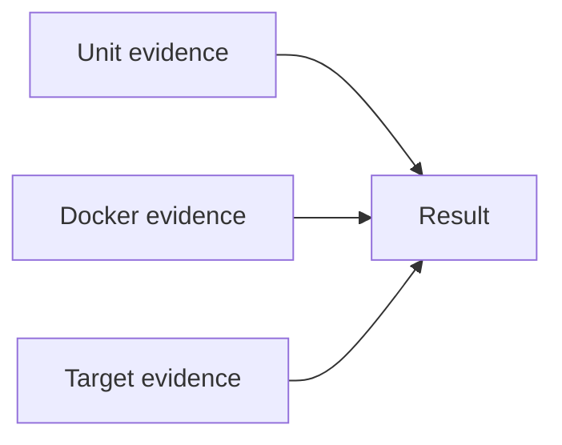

# Oracle to PostgreSQL Application Code Conversion

**Run:** `<run-id>` · **Repository:** `<name>` on `<branch>` from `<commit>` · **Target contract:** `<sanitized target>` · **Plugin:** `<version>`

**Evidence note:** `<commands/evidence provenance and limitations>`

## Table of Contents

- [Executive Conversion Summary](#executive-conversion-summary)
- [Conversion Transformation](#conversion-transformation)
- [Validation Results](#validation-results)
- [Test & Coverage Results](#test-coverage-results)
- [Database Test Environment](#database-test-environment)
- [Remaining Work & Exceptions](#remaining-work-exceptions)
- [Conversion Outcome](#conversion-outcome)
- [Appendix / Execution Evidence](#appendix-execution-evidence)

## Executive Conversion Summary

`<one concise paragraph stating what application/database boundary was converted and across which major surfaces>`

`<one concise paragraph stating what passed and the overall emoji + title-case status, followed only by the customer-action reason preventing production readiness>`

### Conversion Scorecard

| Area | Result | Status |
|---|---|---|
| Application conversion | `<selected boundary and conversion result>` | `<emoji + title-case status>` |
| Build & package | `<compile and deployable artifact result>` | `<emoji + title-case status>` |
| Unit tests | `<final reconciled test result>` | `<emoji + title-case status>` |
| PostgreSQL integration tests | `<real PostgreSQL scenarios/result>` | `<emoji + title-case status>` |
| Target validation | `<contract, DDL, and authorized target-write result>` | `<emoji + title-case status>` |
| Production readiness | `<remaining customer-action boundary or ready statement>` | `<emoji + title-case status>` |

### Next Steps / Actions Needed

The automated conversion and validation are substantially complete. Complete these customer-owned
actions before considering the application production-ready:

| Priority | Area | Action needed | Owner |
|---|---|---|---|
| `<Required or Recommended>` | `<customer-facing area/object>` | `<specific executable action>` | `<customer role/team>` |

> **Recommended production-readiness path:** `<ordered customer handoff from required blockers through deployment, smoke/end-to-end validation, external integrations, and high-value test gaps>`.

The detailed conversion changes, validation evidence, test results, database activity, and
remaining exceptions are documented in the sections below.

[Back to Top](#top)

## Conversion Transformation

| Boundary | Before | After |
|---|---|---|
| `<boundary>` | `<Oracle behavior>` | `<PostgreSQL behavior>` |

### Conversion Scope Reconciliation

| Category | Discovered | Converted | Intentionally retained | Deferred | Safely convertible remaining | Evidence / exact reason |
|---|---:|---:|---:|---:|---:|---|
| `<provider/datasource/SQL/routine/mapping/script/deployment/etc.>` | `<count>` | `<count>` | `<count>` | `<count>` | `0` | `<evidence>` |

The modified-file count is not a scope target. Reconcile every code-derived Oracle finding and keep
safely convertible remaining at zero.

### Oracle DDL Source Reconciliation

| Missing PostgreSQL object | Oracle source / reconstruction provenance | Source DDL file / digest | Body completeness / confidence | PostgreSQL DDL and application call updates | Synthetic Docker validation | Persistent target result / customer validation |
|---|---|---|---|---|---|---|
| `<schema.object(signature)>` | `<oracle-ddl / code-and-tests / best-effort / signature-only-fail-closed>` | `<relative path / short SHA-256 or Not available>` | `<complete/inferred/missing + high/medium/low + limitations>` | `<deploy/undo paths and reconciled call sites>` | `<inputs/rows/assertions/output or expected error/cleanup>` | `<✅ Created and verified / ✅ Already present and verified / ⚠️ Not executed / ❌ Failed / ➖ Option off + exact reason/next action when incomplete + customer validation>` |

Include every code-derived target object that was missing. Objects without a unique authoritative
source match still receive best-effort deploy/undo DDL, call-site reconciliation, and synthetic
Docker validation. Clearly label inferred or missing bodies, assumptions, limitations, and required
customer validation. Do not copy Oracle DDL bodies into the report or present synthetic proof as
proof of omitted business logic.

With `create-persistent-ddl` enabled, report actual selected-target modify execution and immediate
query verification, not just SQL generation or Docker deployment. Reconcile the complete
missing-object count and `optionResults.create-persistent-ddl`; unavailable safety prerequisites
produce an explicit `Not executed` result and `PARTIAL`, never a success-shaped skip.

Promote every inferred or missing-body object requiring customer validation into the executive
**Next Steps / Actions Needed** table as a `Required` database/business-owner action. Production
readiness remains `⚠️ Action needed` even when Docker validation and authorized target creation
pass.

### Unused Artifacts

| Path | Kind | Unused evidence | Build/package references | Action | Result |
|---|---|---|---|---|---|
| `<repository-relative path>` | `<jar/dll/so/config/etc.>` | `<reference and classpath evidence>` | `<counts/evidence>` | `<Retained — option off / Removed — option on>` | `<emoji + title-case result>` |

When no unused artifacts are detected, retain the table and add one `None detected` row. Do not
delete an unused artifact unless `remove-unused-artifacts` is explicitly enabled.

### Before → After Architecture

### Conversion Traceability Map

### Critical Workflow

### Migration Validation Coverage

[Back to Top](#top)

## Validation Results

| Stage / gate | Scope / evidence | Result | Readiness impact |
|---|---|---|---|
| Converted units/files | `<counts/scope>` | `<emoji + title-case result>` | `<impact>` |
| Formatting/compile | `<command/result>` | `<result>` | `<impact>` |
| Test runner/adapter availability | `<source frameworks/effective adapters>` | `<result>` | `<impact>` |
| Test discovery reconciliation | `<eligible/executed containers, representative tests, baseline comparison>` | `<result>` | `<impact>` |
| Broken-test repair | `<failures exposed/repaired/remaining>` | `<result>` | `<impact>` |
| Focused tests | `<waves/tests>` | `<result>` | `<impact>` |
| Module/full tests | `<all engines, baseline reconciliation>` | `<result>` | `<impact>` |
| Docker PostgreSQL runtime validation | `<production paths>` | `<result>` | `<impact>` |
| Integration/end-to-end tests | `<counts/fixtures>` | `<result>` | `<impact>` |
| Packaging/artifact inspection | `<artifacts/drivers>` | `<result>` | `<impact>` |
| Residual Oracle scan | `<active remnants>` | `<result>` | `<impact>` |
| Authoritative target contract validation | `<objects/signatures>` | `<result>` | `<impact>` |
| Authoritative target runtime/write validation | `<authorized scenarios/cleanup>` | `<result>` | `<impact>` |
| Report artifact validation | `validate-migration-artifacts.mjs` command/result | `<result>` | `<impact>` |
| Final readiness | `
` | `<result>` | `<impact>` |

### Runtime Driver Packaging Reconciliation

| Archive | Source → packaged runtime descriptor | Required driver path / pattern | Matching deployment entries | WAR-only copies | Result |
|---|---|---|---|---|---|
| `<deployment ZIP/JAR>` | `<source path> → <archive entry>` | `<exact path or wildcard>` | `<matching archive entries>` | `<entries or None>` | `<emoji + title-case result>` |

Do not treat a PostgreSQL JAR inside the application WAR as proof that an external Liberty/server
library reference is deployable. Reconcile the packaged descriptor and exact deployment archive
path.

### Target Write Test Reconciliation

| Requested | Applicable mutation scenarios | Writable context | Write attempted | MCP modification / driver scenarios | Marker rows inserted / deleted / remaining | Sequence values consumed | Recorded write operations | Option satisfied | Result |
|---|---:|---|---|---:|---|---:|---:|---|---|
| `<yes/no>` | `<count>` | `<profile/access/transaction evidence>` | `<yes/no>` | `<count>` | `<inserted/deleted/remaining>` | `<count>` | `<count>` | `<yes/no>` | `<emoji + title-case result>` |

When requested writes do not execute, use `⚠️ Not executed`, give the exact blocker and next action,
and make the overall conversion `PARTIAL`. Read-only access is not `not applicable`.

[Back to Top](#top)

## Test & Coverage Results

### Test Summary

| Lane / adapter | Baseline | Final | Failures / skips | Reconciliation |
|---|---:|---:|---|---|
| `<lane>` | `<count>` | `<count>` | `<count>` | `<explain any decrease>` |

### Test Discovery Reconciliation

| Language | Framework / adapter | Source files | Test cases | Adapter version | Eligible containers | Executed containers | Executed tests | Missing containers | Result |
|---|---|---:|---:|---|---:|---:|---:|---:|---|
| `<language>` | `<framework / adapter>` | `<count>` | `<count>` | `<version>` | `<count>` | `<count>` | `<count>` | `<count>` | `<emoji + title-case result>` |

State the reviewed baseline path, representative tests proven in fresh native reports, runner
safety settings, failure repairs, and whether any count reduction was intentionally reviewed.

### Broken-Test Repair Reconciliation

| Failure class / suite | Exposed failures / errors | Classification / root cause | Repair attempts | Files repaired | Final result / next action |
|---|---:|---|---:|---|---|
| `<fully qualified class or suite>` | `<failures/errors>` | `<stale injection/matcher/assertion/migration defect/external>` | `<count>` | `<paths or none>` | `<passed or exact unsafe/external action>` |

When `fix-broken-tests` is on, list every exposed failing class. Pre-existing/legacy classification
does not remove it from repair scope.

### Coverage Comparison

| Scope | Metric | Baseline | Final | Δ percentage points |
|---|---|---:|---:|---:|
| Original production classes — fixed comparison set | Lines | `<value>` | `<value>` | `<delta>` |
| `<N> migration-critical classes` | Lines | `<value>` | `<value>` | `<delta>` |
| Final full-production scope | Lines | N/A | `<value>` | N/A |

List every migration-critical class and state that the subset is not all modified files/classes.

### Coverage by Lane

| Lane | Baseline line | Final line | Baseline branch | Final branch | Evidence |
|---|---:|---:|---:|---:|---|
| `<framework/toolchain lane>` | `<value>` | `<value>` | `<value>` | `<value>` | `<path>` |
| 🔗 Integration | `<value>` | `<value>` | `<value>` | `<value>` | `<path>` |
| 📊 Combined | `<value>` | `<value>` | `<value>` | `<value>` | `<path>` |

### Coverage Convergence

| Lane | Wave | Planned behaviors | Tests added / repaired | Line Δ | Branch Δ | Result |
|---|---:|---|---|---:|---:|---|
| `<unit or integration>` | `<wave>` | `<behaviors>` | `<tests>` | `<delta>` | `<delta>` | `<result>` |

State the actual unit and integration wave counts, two-wave minimum per enabled lane, ten-wave
maximum per lane, value evidence for any additional wave, 80% aspiration progress, and stop reason.
Identify validation-only waves and complete-suite execution reused as a final wave.

### Remaining Coverage Gaps

| Area | Uncovered behavior | Classification / evidence | Next action | Status |
|---|---|---|---|---|
| `<area>` | `<behavior>` | `<classification>` | `<action>` | `<emoji + title-case status>` |

[Back to Top](#top)

## Database Test Environment

**Persistent database impact:** `<exact DDL/DML/customer-data impact>`.

### Docker Engine Availability

| Option enabled | Engine running at preflight | Desktop detected | Start attempted | Desktop state changed | Engine responsive | Result / limitation |
|---|---|---|---|---|---|---|
| `<yes/no>` | `<yes/no>` | `<yes/no/not checked>` | `<yes/no>` | `<yes/no>` | `<yes/no>` | `<emoji + title-case result and exact reason>` |

### Synthetic Test Data

| Environment | Table | Fixture loads | Rows created | Peak rows present | Rows reused | Rows cleaned / rolled back | Rows remaining | Status |
|---|---|---:|---:|---:|---:|---:|---:|---|
| `<environment>` | `<schema.table>` | `<count>` | `<count>` | `<count>` | `<count>` | `<count>` | `<count>` | `<status>` |

### Database Objects Exercised with Synthetic Data

| Object kind | Active / code-derived in tested scope | Exercised | Evidence / gap |
|---|---:|---:|---|
| Function | `<count>` | `<count>` | `<evidence>` |
| Procedure | `<count>` | `<count>` | `<evidence>` |
| Sequence | `<count>` | `<count>` | `<evidence>` |
| Table | `<count>` | `<count>` | `<evidence>` |
| View | `<count>` | `<count>` | `<evidence>` |
| Trigger | `<count>` | `<count>` | `<evidence>` |
| Native query path | `<count>` | `<count>` | `<evidence>` |

| Object / signature | Kind | Production entry point | Synthetic fixtures | Invocation form | Assertions / side effects | Environment | Result |
|---|---|---|---|---|---|---|---|
| `<schema.object(args)>` | `<kind>` | `<service/repository/DAO>` | `<tables/counts>` | `<SELECT/CALL/repository/etc.>` | `<outputs/side effects/cleanup>` | `<environment>` | `<result>` |

### Behavior Exercised

| Test / scenario | Production entry point | PostgreSQL objects | Fixture tables / rows | Behavior exercised | Assertions / observed outcome | Result |
|---|---|---|---|---|---|---|---|
| `<scenario>` | `<entry point>` | `<objects>` | `<fixtures>` | `<behavior>` | `<assertions>` | `<result>` |

[Back to Top](#top)

## Remaining Work & Exceptions

### Required Before Production

| Area | Evidence / impact | Required action | Owner / prerequisite |
|---|---|---|---|
| `<area>` | `<impact>` | `<action>` | `<owner>` |

### Recommended

| Area | Reason | Recommended action |
|---|---|---|
| `<area>` | `<reason>` | `<action>` |

### No Action Required

| Area | Evidence |
|---|---|
| `<area>` | `<evidence>` |

[Back to Top](#top)

## Conversion Outcome

`<precise status, successful scope, external dependencies, executable recommendation>`

[Back to Top](#top)

## Appendix / Execution Evidence

### Effective Options

| Option | State | Result |
|---|---|---|
| `<option>` | `<On/Off>` | `<result>` |

### Run Metrics

**Time zone:** `<machine-local IANA time zone captured at run start>`

| Phase | Start | Completed | Wall Clock Duration |
|---|---|---|---|
| Assessment | `<readable start>` | `<readable completed>` | `<readable duration>` |
| Conversion | `<readable start>` | `<readable completed>` | `<readable duration>` |
| Total Runs | `<readable start>` | `<readable completed>` | `<readable duration>` |

### Parallel Execution & Agent Utilization

**Agent facility:** `<available/unavailable>` · **Independent eligible units:** `<count>` ·
**Parallel batches:** `<count>` · **Fallback:** `<exact reason or None>`.

| Batch | Agent / type | Objective / unit | Mode / owned paths | Started | Completed | Result |
|---|---|---|---|---|---|---|
| `<batch>` | `<agent-id / type>` | `<objective / unit IDs>` | `<read-only or write paths>` | `<timestamp>` | `<timestamp>` | `<concise result>` |

List every assignment. When agents were available and two or more independent units existed, show
at least one batch containing overlapping child-agent execution.

### Performance & Execution Efficiency

| Control | Evidence | Result |
|---|---|---|
| Dependency warmup | `<one phase / commands / status>` | `<result>` |
| Test compilation | `<count / compiled-input digest / invalidations>` | `<result>` |
| Shared Docker environment | `<owned identity digest / process reuse / fixture isolation / cleanup>` | `<result>` |
| Setup reuse | `<warmup/compiled-output reuse / invalidations>` | `<result>` |
| Stage timing | `<generation / compatibility repair / readiness / test execution / reporting>` | `<result>` |
| Precompiled waves | `<direct/offline / unit + integration count / unique XML + exec>` | `<result>` |
| Coverage generation | `<CLI merge / native test XML per wave / final coverage XML / HTML count>` | `<result>` |
| Complete suite | `<one direct precompiled execution>` | `<result>` |
| Pre-package checks | `<source/classification/archive plan>` | `<result>` |
| Final clean package | `<one clean package / tests already passed>` | `<result>` |
| Archive inspection | `<archives / required + forbidden entries>` | `<result>` |
| Agent waits | `<background notifications / blocking seconds>` | `<result>` |
| Target metadata | `<batched parallel read-only checks / no parallel writes>` | `<result>` |

### Changes Inventory

#### Modified tracked files

**Summary:** `<count> tracked files; <additions> additions; <deletions> deletions; <total> changed lines`.

| Path | Git change | Conversion unit / category | Updated line ranges | Result / purpose |
|---|---|---|---|---|
| [`<path>`](file-diffs.md#file-00001) | modified | `<unit>` | `<ranges>` | `<purpose>` |

#### New source and test files

| Path | Git change | Conversion unit / category | Result / purpose |
|---|---|---|---|
| `<path>` | added | `<unit>` | `<purpose>` |

#### Deleted or renamed files

| Path | Git change | Conversion unit / category | Result / purpose |
|---|---|---|---|
| `<path or None>` | `<kind>` | `<unit>` | `<purpose>` |

#### Generated migration artifacts

| Path | Git change | Artifact category | Purpose |
|---|---|---|---|
| `.github/migrate-oracle-app/conversions/file-diffs.md` | generated | Diff evidence | Sanitized per-file before/after hunks |

### Git Evidence

| Field | Evidence |
|---|---|
| Repository root | `<path>` |
| Starting branch / commit | `<branch/commit>` |
| Final tracked diff | `<counts>` |
| Staging/commit/push | None |

[Back to Top](#top)
